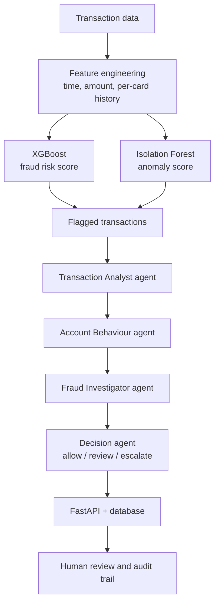

# FinGuard AI

**Agentic AI for banking fraud detection and investigation.**

A machine-learning engine scores card transactions for fraud. For the ones it flags, a team of
[Google ADK](https://adk.dev) agents investigates the evidence, explains the risk and recommends
`allow`, `review` or `escalate`. A FastAPI service stores every investigation, supports human
review and keeps an audit trail.

> **Data note:** this project uses a *synthetic* public dataset. Results show that the system works
> end to end; they are not a claim about performance on real bank data. See [Limitations](#limitations).

## Highlights

- **Fraud model:** XGBoost reaches **PR-AUC 0.88** on a held-out later time period (random guessing = 0.004).
- **Cost-aware threshold:** tuned on validation data to minimise simulated loss, cutting it by about **93%** versus no detection (assumes a $10 analyst review cost per flagged transaction).
- **No-leakage features:** per-card history features use only earlier transactions, enforced by unit tests.
- **Multi-agent investigation:** four ADK agents (analysis, account behaviour, investigation, decision) with tools, shared state and a structured JSON decision.
- **Honest evaluation:** agents are scored against ground truth they never see, and prompts were tuned on one sample and evaluated on a different one.
- **Service layer:** REST API, database, human-in-the-loop review and an append-only audit trail.

## Architecture



Agents never see the fraud label. They reach the data through four tools:
`get_transaction_details`, `explain_risk_factors` (XGBoost feature contributions),
`get_card_history` (strictly prior transactions) and `list_flagged_transactions`.

## Results

**Data:** 1,296,675 training and 555,719 test transactions, 983 cards. Fraud is 0.58% of training
and 0.39% of test transactions. Train and test are split by time.

### Fraud model (test set)

| Metric | Value |
|---|---|
| XGBoost PR-AUC | **0.882** (random guessing: 0.0039) |
| XGBoost ROC-AUC | 0.997 (flattering on imbalanced data; PR-AUC is the honest number) |
| Isolation Forest PR-AUC | 0.164, with no labels used |
| Decision threshold | 0.14, chosen on a validation slice |
| Frauds caught / missed | 1,958 / 187 (recall 91.3%) |
| False alarms | 2,239 (precision about 47%) |
| Simulated loss | $74.8K with the model versus $1.13M with no detection |

Findings worth noting:
- The strongest features are night-time (`is_night`), transaction amount, merchant category and how
  the amount compares with the card's own history.
- `distance_km` between home and merchant carries almost no signal in this dataset.
- Adding Isolation Forest as an extra "also flag" rule did **not** reduce cost, so it is used as an
  explanatory signal for the agents rather than a decision rule.

### Agent evaluation

Flagged transactions are sampled (half real fraud, half false alarms), run through the agents, and
compared with ground truth.

| Run | Cases | Fraud sent to a human | Fraud wrongly allowed | False alarms cleared |
|---|---|---|---|---|
| Prompt v1 (seed 42, development) | 20 | 10 / 10 | 0 | 4 / 10 |
| Prompt v2 (seed 42, development) | 20 | 10 / 10 | 0 | 8 / 10 |
| **Final (seed 7, fresh cases)** | _pending_ | _pending_ | _pending_ | _pending_ |

v1 to v2 came from reading the agents' reasoning and fixing a misleading tool output (a "top 3 usual
hours" list made normal late-night activity look unusual) and the prompts. Because v2 was tuned on
the seed-42 cases, those numbers are optimistic. The seed-7 row is the one to trust.

## Project structure

```
finguard-ai/
├── finguard_agent/         ADK entry point (agents and pipeline)
├── src/finguard/
│   ├── config.py           paths, constants, .env loading
│   ├── ml/                 features.py, train.py
│   ├── agents/tools.py     tools the agents call
│   ├── evaluation/         agent evaluation against ground truth
│   └── api/                FastAPI service, database, schemas
├── notebooks/              exploration: EDA, features, training
├── tests/                  unit tests for the feature pipeline
├── data/  models/  reports/   (data and models are not committed)
└── requirements.txt
```

## Quick start

```bash
git clone https://github.com/Anjali9815/finguard-ai.git
cd finguard-ai
python3 -m venv venv && source venv/bin/activate
pip install -r requirements.txt

# 1. Data: Kaggle "Credit Card Transactions Fraud Detection" (kartik2112/fraud-detection)
kaggle datasets download -d kartik2112/fraud-detection -p data/raw --unzip

# 2. Train models and create the scored transaction store
python -m src.finguard.ml.train

# 3. Run the tests
python -m pytest -q

# 4. Agents need a Gemini key in a .env file at the project root
echo "GOOGLE_API_KEY=your_key_here" > .env
adk web                                   # then open finguard_agent and send:
                                          # "Investigate transaction <trans_num>"

# 5. Evaluate the agents against ground truth
python -m src.finguard.evaluation.eval_agents --per-class 50 --seed 7 --out eval_seed7_final.csv

# 6. REST API (docs at http://127.0.0.1:8000/docs)
FINGUARD_MOCK_AGENT=1 uvicorn src.finguard.api.main:app --reload   # mock mode: no Gemini calls
uvicorn src.finguard.api.main:app --reload                         # real agents
```

### API overview

| Endpoint | Purpose |
|---|---|
| `GET /queue` | Transactions the model flagged, highest risk first |
| `GET /transactions/{id}/evidence` | Score, risk factors and card history (no LLM) |
| `POST /investigations` | Run the agent pipeline and store the result (re-uses stored results to save quota) |
| `POST /investigations/{id}/review` | Human analyst confirms or overrides the decision |
| `GET /investigations/{id}/audit` | Audit trail |
| `GET /metrics` | Decision counts, pending reviews, human override rate |

Mock mode returns a simple rule-based result labelled `source: "mock"`, so it can never be mistaken
for an agent decision.

## Design decisions

- **Time-based split, past-only history.** Training uses earlier data and testing uses later data.
  Card history features are computed from earlier transactions only, with a unit test that fails if
  they ever use later ones.
- **Imbalance handled by class weights**, with evaluation kept on the true, imbalanced distribution.
  Metrics are PR-AUC, precision and recall, not accuracy.
- **Threshold chosen by cost on validation data**, then applied to the test set once.
- **Sensitive attributes excluded.** Gender, job and state are not model inputs.
- **Risk score, not probability.** Heavy class weighting inflates scores, so agents are instructed to
  call the output a "risk score".
- **Agents are evaluated, not assumed to help.** The evaluation harness measures decisions against
  ground truth and exposes where the agents are wrong.

## Limitations

- **Synthetic data.** Fraud patterns here are cleaner than in real systems, so real-world
  performance would be lower. Some fields (for example, merchant distance) carry no signal.
- **Assumed review cost.** The $10 per flagged transaction is an assumption; the best threshold
  changes with real costs.
- **Small agent evaluation.** The agent sample is small; confidence intervals are wide.
- **Scores are not calibrated probabilities.**
- **No live deployment.** Drift monitoring, A/B or shadow testing and latency under load have not
  been exercised on real traffic.

## Roadmap

Online scoring endpoint for raw transactions, Docker and PostgreSQL, CI, MLflow experiment tracking,
drift and agent monitoring dashboard, cloud deployment, scheduled retraining.

## Tech stack

Python, pandas, scikit-learn, XGBoost, Google ADK (Gemini), FastAPI, SQLAlchemy (SQLite, with
PostgreSQL support), pytest.